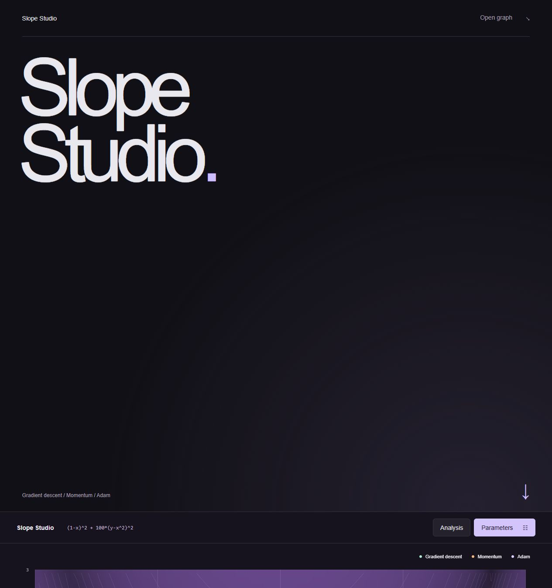

# Slope Studio

A two-variable automatic-differentiation and optimization workbench. Compile an expression into an inspectable reverse-mode tape, compare its gradients with central differences, and trace gradient descent, momentum, and Adam across the same sampled loss surface.



The selected optimizer trace has a soft glow and a ring around its inspected point. Sampled surface colors, contours, and grid are cached per experiment and canvas size for scrubbing; path and point overlays still reflect the selected trace. New experiments fade in, and drawers animate in both directions while preserving native modal focus behavior. These transitions respect reduced-motion preferences.

## Run

Python 3.10+ serves the local page; a modern browser performs the numerical work in a Web Worker. Node 22+ is needed only for development checks. There are no installed runtime dependencies or remote services.

```sh
python run.py --port 8000
```

Open http://127.0.0.1:8000. The loopback server exposes only five static assets. Experiments are local and ephemeral until saved; **Open experiment** restores a downloaded settings file.

## Explore

Scroll from the title to the full-screen graph. Open **Parameters** to choose Rosenbrock's valley, an anisotropic quadratic, a rippled nonconvex surface, or a stationary saddle. Edit the expression, starting coordinates, shared learning rate, and step budget. Optional controls set gradient norm clipping, gradient tolerance, and plot bounds.

Run all three optimizers, select one, and scrub or play its trace. At each valid point, inspect the loss, raw gradient, finite-difference diagnostic, and every forward value/local derivative/adjoint in the tape. Click the landscape to start another experiment; keyboard arrows adjust the start by 1% of the displayed span and Enter runs it.

Use **Analysis** for the loss-history chart, comparison table, derivative tape, and exports. Save experiment settings from **Parameters**. Export complete evidence JSON or all optimizer traces as CSV, and save the landscape plot as PNG. [Example settings](docs/example.json) and [example landscape](docs/example-landscape.png) are included.

The default Rosenbrock study starts at (-1.2, 1), uses a learning rate of 0.002, and runs 1,000 updates without clipping. Final losses are approximately 0.07069474 for gradient descent, 1.7678e-8 for momentum, and 3.99461913 for Adam. All three hit the step budget. This shared-rate comparison is not a tuned benchmark or a universal ranking of optimizers.

## Expression and derivative engine

Supported grammar: x/y, decimal/scientific numeric constants, `+ - * /`, parentheses, integer literal powers `^0` through `^8`, and `sin`, `cos`, `exp`, `log`, `sqrt`. Unary minus has conventional precedence: `-x^2` means `-(x^2)`. Arbitrary code, variable exponents, implicit multiplication, and other functions are rejected.

The compiler creates a topologically ordered tape and reuses one node per variable. Forward evaluation records values and local derivatives. Reverse accumulation seeds the output adjoint with one and adds each outgoing contribution to its input, so repeated uses such as `x*x+x*y+x` correctly accumulate at x. The tape displays those intermediate values and adjoints at the selected trace point.

Central differences independently probe each coordinate with `h = 1e-5 * max(1, abs(coordinate))`. The diagnostic reports absolute error in the export and scaled error in the interface, divided by `max(1, abs(automatic), abs(numerical))`. Invalid neighboring probes are explicitly unavailable. Finite differences are approximate and can suffer cancellation; their agreement is diagnostic, not a proof of correctness.

## Optimizer contract

All methods use the same starting point, rate, stopping tolerance, budget, and optional clipping setting. There is no stochastic sampling, line search, or constraint projection.

- Gradient descent: `point -= rate * gradient`.
- Momentum: `velocity = 0.9 * velocity + gradient`, then `point -= rate * velocity`.
- Adam: first/second moment decay 0.9/0.999, bias correction at each update, and epsilon 1e-8 outside the square root.

When enabled, norm clipping scales the gradient before optimizer state updates. Recorded gradients and gradient-tolerance checks use the raw derivative. Trace index zero is the initial point; a budget of N updates permits N+1 valid points. Domain/arithmetic failures retain the valid prefix and record the failed proposed point separately. Coordinate-bound failures likewise preserve valid history.

“Gradient tolerance reached” means stationarity only. The saddle preset `x^2-y^2` at (0,0) stops immediately with zero gradient; this is not a minimum. Runs may converge to local minima, oscillate, diverge, or stop at an invalid domain.

References: [Stanford's backpropagation example](https://cs231n.stanford.edu/slides/2025/lecture_4.pdf) and [Kingma & Ba's Adam paper](https://arxiv.org/abs/1412.6980).

## Plots and numerical boundaries

The landscape uses 64×64 cell-center loss samples. Colors and interpolated contour lines scale by `log(1 + value - sampled_minimum)`; this is not an exact contour reconstruction or a computed global minimum. Undefined cells are gray. Paths use actual trace coordinates and clip at the selected plot bounds; out-of-view point counts are reported. The loss-history vertical axis uses `sign(f)*log(1+abs(f))`, allowing negative losses without silently dropping them.

Expressions: at most 1,000 characters, 300 tokens, 100 tape nodes, and 32 parser nesting levels. Constant magnitude is at most 1e6. Starting coordinates and plot bounds stay within ±100; each plot axis spans at least 0.01. Rate 1e-6–1; budget 1–2,000 integer updates; clip 0–10,000 (zero disables); tolerance 1e-12–1. Imported settings are limited to 50 KB and validated before populating controls.

Values and local/reverse derivatives must remain finite with magnitude at most 1e100. Proposed optimizer coordinates beyond ±1e6 stop the run. log requires a positive input; division by zero fails. sqrt at zero is allowed as a surface value but rejected for gradient evaluation because its local derivative is infinite—even if a larger algebraic expression could simplify to a differentiable function. Integer power zero has value one and derivative zero, including at zero. Arithmetic uses JavaScript binary64.

Saved settings and exported traces reflect the last completed experiment, not unsubmitted form edits. Evidence also includes the selected optimizer point, its tape, and its numerical checks. Plot playback is user-initiated; no background optimization continues after the worker completes.

## Verification

```sh
node --test
npm run check
python -m unittest discover -s tests -v
```

Twelve JavaScript tests and one HTTP-boundary test cover shared-variable accumulation, precedence, function derivatives, 300 symbolic Rosenbrock gradient checks, 200 independently differentiated composed-expression checks, finite-difference boundary failures, exact quadratic descent recurrence, momentum/Adam updates, clipping, stationary saddles, numerical/domain stops, sampling, bounds, and reproducibility. CI runs Node 22/24 on Linux and Node 24 on Windows.

Browser validation exercised playback, optimizer/iteration selection, numerical checks and tape inspection, the stationary saddle, keyboard/pointer starting points, domain-error feedback, all exports, and saved-setting import. A separate Python analytic-gradient replay reproduced all 3,003 default trace points and CSV values; the original PNG export was verified as 720×520 pixels. The redesigned canvas now exports at its current viewport size and device pixel ratio (capped at 2), with responsive contour rendering. The redesign was checked at desktop and 390-pixel mobile widths, including drawer focus/Escape, parameter submission, iteration selection, and stable graph position while recomputing.

`core.js` owns compilation, differentiation, optimizers, and sampling; `worker.js` isolates numerical work; `app.js` renders safe text, canvas/SVG plots, and inspectable evidence. `run.py` is a small allowlisted loopback server with a restrictive content-security policy.
